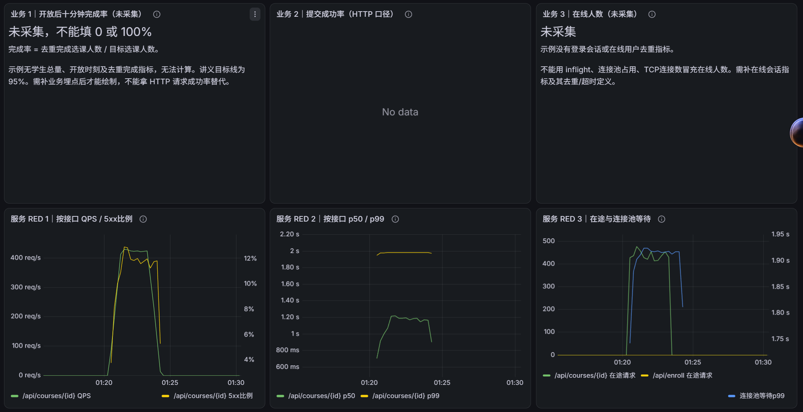
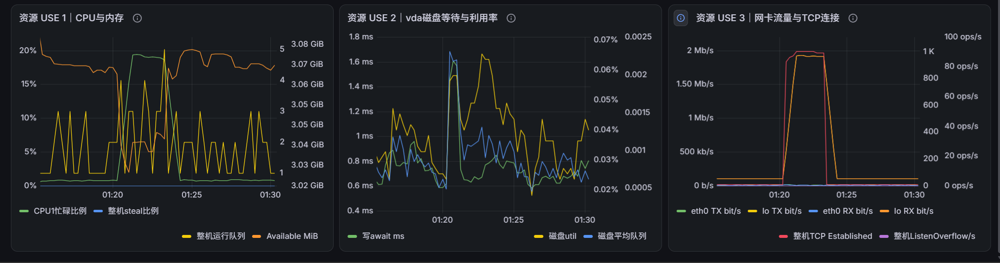

# 实验 2 记录：第 10组

评分时依据本文件和 `runs/` 中的原始数据核对。本文件中的每一个数值，都须能在某个 `runs/<名字>/` 的文件中找到：表格用 `scripts/table.sh` 生成后粘贴，其他数值注明出处（例如“`runs/r1-pool4/red.csv` 第 6 阶段”）。不要只贴截图。将 `<填写>` 替换为本组的内容。

第 4.1、4.4、5.1、5.3 节的预测须在对应的测量之前写好，写好后不要修改。预测错误不扣分，与实测不一致之处在分析中讨论。

## 1. 基本信息

| 项 | 内容 |
|---|---|
| 小组 | 第 10 组 |
| 仓库地址 | https://github.com/workonemptymirror/ops-lab2-10.git|
| 主机 | 华为云的 2 vCPU 4 GB 通用型|
| CPU | Model name：General Purpose Processor；vCPU 数：2；lscpu -e 中 CPU 0、1 对应的 CORE 均为 0 |
| 内存 | free -m 的 total：3741 MB |
| 数据目录所在的盘 | findmnt -T data：SOURCE=/dev/vda2，FSTYPE=ext4，挂载点=/；通用型 SSD 云盘 40 GB>|
| 操作系统与内核 | PRETTY_NAME：Huawei Cloud EulerOS 3.0 (x86_64)；uname -r：6.6.0-72.0.0.76.r1361_99.hce3.x86_64 |
| Go、Prometheus、node_exporter |Go：go1.26.9 linux/amd64；Prometheus：prometheus, version 3.13.4；node_exporter：node_exporter, version 1.12.1 |
| 分核 | enrolld：1；loadgen、Prometheus、node_exporter：0|

## 2. 任务 0：基线

`bin/enrolld -bench-fsync 2000` 连续运行三次的输出：

```text
fsync 次数 2000，总耗时 3.07 s，数据目录 data
fsync 耗时（毫秒）：mean 1.532  p50 1.359  p90 1.958  p99 4.365  max 15.087
按平均值推算，一个写者串行 fsync 每秒最多约 653 次（= 1000 / 1.532）
fsync 次数 2000，总耗时 2.91 s，数据目录 data
fsync 耗时（毫秒）：mean 1.449  p50 1.309  p90 1.748  p99 4.309  max 9.509
按平均值推算，一个写者串行 fsync 每秒最多约 690 次（= 1000 / 1.449）
fsync 次数 2000，总耗时 2.80 s，数据目录 data
fsync 耗时（毫秒）：mean 1.393  p50 1.286  p90 1.598  p99 3.593  max 11.239
按平均值推算，一个写者串行 fsync 每秒最多约 718 次（= 1000 / 1.393）
```

按平均值计算，单个写者串行 fsync 每秒最多约 686 次。三次之间相差多少？推算上限在 653～718 次/秒之间，极差 65 次/秒，约 9.5%；平均 fsync 耗时在 1.393～1.532 ms 之间，相差约 0.14 ms。 以均值 686 为基准，单次波动约 ±5%

空载和运行 fsync 测试时各工具的读数（各观察 5 秒以上，填写典型值）：

| 工具与列 | 空载 | 运行 `-bench-fsync` 时 | 该列的含义 |
|---|---|---|---|
| `vmstat -w 1`：r、b | r=0, b=0 | r=0~2, b=1 | r：可运行队列长度；b：不可中断睡眠（阻塞）进程数 |
| `vmstat -w 1`：us、sy、id、wa、st | us=0, sy=0~1<br>id=99~100, wa=0, st=0 | us=0~1, sy=2~3<br>id=47~58, wa=38~48, st=0 | us：用户态 CPU 时间；sy：内核态；id：空闲；wa：等 I/O；st：被虚拟化层偷走的时间 |
| `iostat -dx 1 <盘>`：w/s、wkB/s | w/s=0~12<br>wkB/s=0~80 | w/s≈1976~2227<br>wkB/s≈10728~12020 | w/s：每秒写次数；wkB/s：每秒写 KB 数 |
| `iostat -dx 1 <盘>`：w_await、f/s、f_await | w_await=0.5~1.5<br>f/s=0~2, f_await=0 | w_await≈0.49<br>f/s≈1308~1474, f_await≈0.04 | w_await：写请求平均等待时间(ms)；f/s：每秒 fsync 次数；f_await：fsync 平均等待时间(ms) |
| `iostat -dx 1 <盘>`：aqu-sz、%util | aqu-sz=0~0.01<br>%util=0~0.3 | aqu-sz≈1.02~1.04<br>%util≈94.80~97.40 | aqu-sz：平均请求队列长度；%util：设备利用率百分比 |

运行 fsync 测试时，CPU 是否繁忙？哪几列表明存在等待？运行 fsync 测试时 CPU 并不繁忙。从 vmstat 可以看出，用户态 us 仅为 0~1，内核态 sy 仅为 2~3，系统仍有 47%~58% 的 CPU 处于空闲状态（id）。表明存在等待的列有：

vmstat 的 wa（I/O 等待） 从 0 飙升至 38~48，说明有大量 CPU 时间在等待磁盘操作完成；同时 b（阻塞进程数） 出现了 1，说明有进程因为等待 I/O 而进入不可中断睡眠。

iostat 的 %util（设备利用率） 从接近 0 飙升至 94.8%~97.4%，说明磁盘在测试期间几乎一直处于满负荷工作状态。w/s 和 f/s 的大幅上升也证实了瞬间产生了大量的底层写和 fsync 操作。

## 3. 任务 1：指标流水线

两个抓取目标的状态（`curl -s 127.0.0.1:9090/api/v1/targets` 中两处 `"health"` 的值）：`up`、`up`

本组编写的四条查询（与 `deploy/queries-red.txt` 一致）：

```text
server_rps          sum(rate(http_requests_total{route="${route}"}[${window}]))
server_error_rate   (sum(rate(http_requests_total{route="${route}",code=~"5.."}[${window}])) or vector(0)) / sum(rate(http_requests_total{route="${route}"}[${window}]))
server_p99_ms       histogram_quantile(0.99, sum by (le) (rate(http_request_duration_seconds_bucket{route="${route}"}[${window}]))) * 1000
server_slo_good     sum(rate(http_request_duration_seconds_bucket{route="${route}",code="200",le="${slo}"}[${window}])) / sum(rate(http_requests_total{route="${route}"}[${window}]))
```

`runs/t1-light` 的数据（`scripts/table.sh runs/t1-light ok_rps mean_ms p99_ms server_rps server_mean_ms server_p99_ms cpu_ms_per_req db_query_mean_ms`）：

| step | target_rps | ok_rps | mean_ms | p99_ms | server_rps | server_mean_ms | server_p99_ms | cpu_ms_per_req | db_query_mean_ms |
|---|---|---|---|---|---|---|---|---|---|
| 1 | 0 | 0.0 | - | - | 0 | NaN | NaN | +Inf | NaN |
| 2 | 50 | 50.5 | 11.32 | 12.47 | 51.2917 | 10.6728 | 19.9 | 0.44543 | 10.2707 |
| 3 | 100 | 97.8 | 11.48 | 14.11 | 95.875 | 10.8291 | 19.9043 | 0.435219 | 10.3889 |
| all | - | 74.2 | 11.43 | 13.62 | - | - | - | - | - |

从这次实验读出：每次查询实际占用连接 **10.3889** ms（`db_query_mean_ms`，`runs/t1-light/red.csv` 中 `step=3` 的数据行（目标到达率 100 请求/秒））；每个请求消耗的 CPU **0.435219** ms（`cpu_ms_per_req`，取 100 请求/秒的阶段）。

第 1 阶段是到达率为 0 的空载基线。服务进程仍消耗少量 CPU，但请求速率为 0，因此计算得到的 `cpu_ms_per_req` 为 `+Inf`；没有数据库查询，`db_query_mean_ms` 为 `NaN`。这两个值均不用于估计每请求开销。

## 4. 任务 2：读路径

### 4.1 预测（R1 之前写）

| 资源 | 容量 | 每个请求占用（数据来源） | 推算的上限（请求/秒） |
|---|---|---|---|
| 连接池 | `-pool 4`，共 4 个连接 | 10.3889 ms（`runs/t1-light`，100 RPS 阶段的 `db_query_mean_ms`） | 4 × 1000 / 10.3889 ≈ **385.03** |
| CPU | enrolld 的 1 个核（`GOMAXPROCS=1`） | 0.435219 ms（`runs/t1-light`，100 RPS 阶段的 `cpu_ms_per_req`） | 1 × 1000 / 0.435219 ≈ **2297.69** |

先达到上限的是：**数据库连接池**。

预计从多少请求/秒起，客户端 p99 超过 50 ms：**约 385 请求/秒附近，具体临界值待 R1 实测验证。**

理由：根据低负载测量数据，连接池理论上限约为 385 RPS，明显低于 CPU 理论上限约 2298 RPS，因此预计连接池首先成为瓶颈。随着请求到达率接近连接池上限，连接池使用率逐渐接近 100%，请求开始等待空闲连接，排队时间增加，导致客户端 p99 延迟升高，可能超过 50 ms。由于低负载测量无法准确预测尾延迟超过 50 ms 的具体位置，因此需要通过 R1 实验验证。

R1 的到达率（`scripts/rates.sh 385` 的输出）：`77,154,231,270,308,347,385,424,462`

### 4.2 R1：`-pool 4`

`scripts/table.sh runs/r1-pool4 ok_rps error_rate p99_ms server_p99_ms server_mean_ms inflight_avg cpu_ms_per_req pool_in_use_avg pool_wait_p99_ms sched_wait_p99_ms svc_cpu_busy procs_running_avg`：

| step | target_rps | ok_rps | error_rate | p99_ms | server_p99_ms | server_mean_ms | inflight_avg | cpu_ms_per_req | pool_in_use_avg | pool_wait_p99_ms | sched_wait_p99_ms | svc_cpu_busy | procs_running_avg |
|---|---|---|---|---|---|---|---|---|---|---|---|---|---|
| 1 | 77 | 79.0 | 0.0000 | 13.03 | 19.9 | 10.7549 | 0.8 | 0.432298 | 0.8 | 1.21625 | 0.488308 | 0.046 | 2.4 |
| 2 | 154 | 152.8 | 0.0000 | 17.96 | 19.9189 | 11.1195 | 1.84 | 0.425797 | 1.8 | 7.47203 | 0.487717 | 0.0755 | 2 |
| 3 | 231 | 230.8 | 0.0000 | 22.43 | 33.506 | 11.9114 | 2.36 | 0.426629 | 2.24 | 13.1493 | 0.488729 | 0.1135 | 3.6 |
| 4 | 270 | 274.9 | 0.0000 | 31.45 | 46.934 | 13.7762 | 3.24 | 0.42554 | 2.56 | 21.2986 | 0.487491 | 0.13 | 2.8 |
| 5 | 308 | 312.0 | 0.0000 | 45.80 | 49.2451 | 16.0774 | 5.2 | 0.421927 | 3.32 | 44.539 | 0.488166 | 0.143 | 3.8 |
| 6 | 347 | 342.9 | 0.0000 | 58.62 | 84.7684 | 21.1223 | 6.4 | 0.422625 | 3.56 | 49.5612 | 0.488353 | 0.159 | 3.6 |
| 7 | 385 | 385.6 | 0.0070 | 1007.80 | 1517.77 | 535.065 | 208.08 | 0.438521 | 4 | 994.371 | 0.489889 | 0.179 | 3.8 |
| 8 | 424 | 373.7 | 0.1096 | 1011.65 | 1982.95 | 998.117 | 418.64 | 0.41495 | 4 | 1907.83 | 0.489498 | 0.1835 | 3.6 |
| 9 | 462 | 374.9 | 0.1903 | 1012.00 | 1987.15 | 1002.34 | 463.24 | 0.418172 | 4 | 1948.8 | 0.490881 | 0.2065 | 3 |
| all | - | 280.7 | 0.0514 | 1011.16 | - | - | - | - | - | - | - | - | - |

最大吞吐量 **385.6 请求/秒**，出现在第 **7** 阶段；客户端 p99 首次超过 50 ms 是在第 **6** 阶段（目标到达率 **347 请求/秒**，实际成功吞吐量为 **342.9 请求/秒**）。


### 4.3 CPU 消耗在何处

在约 0.8 倍上限的负载下采集 20 秒 CPU 剖析，`go tool pprof -top` 的前 10 行（同时保存在 `runs/r1-pool4/pprof-top.txt`）：

```text
File: enrolld
Type: cpu
Duration: 20s, Total samples = 2540ms (12.70%)
Showing nodes accounting for 2480ms, 97.64% of 2540ms total

      flat  flat%   sum%        cum   cum%
    2380ms 93.70% 93.70%     2380ms 93.70%  main.spin (inline)
     100ms  3.94% 97.64%      100ms  3.94%  internal/runtime/syscall/linux.Syscall6
         0     0% 97.64%       40ms  1.57%  bufio.(*Writer).Flush
         0     0% 97.64%       40ms  1.57%  internal/poll.(*FD).Write
         0     0% 97.64%       50ms  1.97%  internal/poll.ignoringEINTRIO (inline)
         0     0% 97.64%       50ms  1.97%  internal/runtime/syscall/linux.EpollWait
         0     0% 97.64%     2400ms 94.49%  main.(*server).handleCourse
         0     0% 97.64%     2400ms 94.49%  main.(*server).instrument.func1
         0     0% 97.64%       40ms  1.57%  net.(*conn).Write
         0     0% 97.64%       40ms  1.57%  net.(*netFD).Write
```

`main.spin` 占 **93.70%**；按本次相近负载阶段的吞吐量和 enrolld 消耗的 CPU 计算，每个请求约 **0.421927 ms**，其中 spin 约 **0.39535 ms**，其余约 **0.02658 ms** 消耗在：**系统调用、网络 I/O、HTTP 请求处理、响应写入以及 Go 运行时等非 spin 操作中。**

### 4.4 R2：调大连接池（预测在 R2 之前写）

| 项 | 值与算法 |
|---|---|
| 每个请求占用的 CPU（取 R1 哪一阶段的 `cpu_ms_per_req`，选取理由） | **0.422625 ms/请求**。取 R1 第 6 阶段（目标到达率 347 RPS，成功吞吐 342.9 RPS）。该阶段无错误，尚未出现吞吐平台，且负载较高，可以较好地代表接近饱和前的每请求 CPU 开销。 |
| 推算的 CPU 上限 C | **C = 1 × 1000 / 0.422625 ≈ 2366.16 请求/秒** |
| R2 的池大小 P2 = ceil(2 × C × 每次查询的秒数) | 第 6 阶段 `db_query_mean_ms = 10.5082 ms = 0.0105082 s`；P2 = ceil(2 × 2366.16 × 0.0105082) = **50 个连接** |
| R2 的到达率（`scripts/rates.sh C 0.3 0.6 0.8 0.9 1.0 1.1 1.25 1.5`） | 710,1420,1893,2130,2366,2603,2958,3549 |
| 预测：R2 中先达到上限的是 | **CPU**。扩大连接池后，连接池预测上限约 4758 RPS，高于 CPU 预测上限约 2366 RPS，因此预计 CPU 首先饱和。 |

`scripts/table.sh runs/r2-pool50 ok_rps error_rate p99_ms server_p99_ms inflight_avg cpu_cores cpu_ms_per_req cpu_wait_threads sched_wait_p99_ms pool_in_use_avg svc_cpu_busy procs_running_avg cpu_psi_some`：

| step | target_rps | ok_rps | error_rate | p99_ms | server_p99_ms | inflight_avg | cpu_cores | cpu_ms_per_req | cpu_wait_threads | sched_wait_p99_ms | pool_in_use_avg | svc_cpu_busy | procs_running_avg | cpu_psi_some |
|---|---|---|---|---|---|---|---|---|---|---|---|---|---|---|
| 1 | 710 | 714.9 | 0.0000 | 13.05 | 19.9 | 7.48 | 0.297754 | 0.415639 | 0.280682 | 0.503318 | 7.48 | 0.312 | 3.8 | - |
| 2 | 1420 | 1421.0 | 0.0000 | 13.88 | 19.9 | 13.96 | 0.57244 | 0.404432 | 0.541349 | 1.60107 | 13.96 | 0.586 | 4.4 | - |
| 3 | 1893 | 1884.7 | 0.0000 | 15.86 | 19.9 | 20.24 | 0.758272 | 0.402231 | 0.704568 | 3.66772 | 20.24 | 0.772 | 5.8 | - |
| 4 | 2130 | 2123.5 | 0.0000 | 18.28 | 19.9 | 22.2 | 0.84616 | 0.399942 | 0.747769 | 4.71433 | 22.2 | 0.859 | 5 | - |
| 5 | 2366 | 2361.1 | 0.0000 | 35.18 | 19.9032 | 24.44 | 0.937869 | 0.398048 | 0.393718 | 15.7747 | 24.44 | 0.9515 | 5.6 | - |
| 6 | 2603 | 1821.4 | 0.3019 | 1918.63 | - | 46 | - | - | - | - | 46 | 0.9995 | 4.4 | - |
| 7 | 2958 | 422.9 | 0.8570 | 1994.03 | 145.455 | 55 | 0.622438 | 0.41434 | 0.0355333 | 1000 | 39.6667 | 1.0005 | 5.4 | - |
| all | - | 1535.6 | 0.2361 | 1608.26 | - | - | - | - | - | - | - | - | - | - |

最大吞吐量 **2361.1 请求/秒**，出现在第 **5** 阶段（目标到达率 2366 RPS）；与预测的 C = 2366.16 请求/秒相差 **5.06 请求/秒**，相对偏差约 **0.21%**。

在第 5 阶段，CPU 忙碌度为 95.15%，连接池平均占用仅为 24.44/50，说明 CPU 已接近饱和，而连接池仍有余量。

当目标到达率增加至 2603 RPS 时，CPU 忙碌度达到 99.95%，成功吞吐下降至 1821.4 RPS，错误率达到 30.19%。

进一步提高至 2958 RPS，错误率达到 85.70%，成功返回比例仅约 14.30%，低于负载生成器的 50% 阈值，因此触发 -stop-below 自动停止机制，未执行最后的 3549 RPS 阶段。

实验结果表明，扩大连接池后，首先达到上限的资源由 R1 中的数据库连接池转变为 CPU。预测上限与最大观测成功吞吐量接近，验证了容量估算的有效性。

本次实验未执行第 8 阶段，属于负载生成器的过载保护机制，相关记录保存在 runs/r2-pool50/loadgen.log 中。

## 5. 任务 3：写路径

### 5.1 预测：`-sync each`（W1 之前写）

| 项 | 值与算法 |
|---|---|
| fsync 平均耗时（任务 0） | 1.458 ms |
| 推算的最大 TPS | 1000 / 1.458 ms ≈ 685.8 ≈ 686 TPS |
| 达到上限时 enrolld 大约使用几个核（写路径没有 spin，按 4.3 节拆分出的“spin 以外的开销”估计每个写请求的 CPU） | ~0.018 core |
| W1 的到达率（`scripts/rates.sh <最大 TPS> 0.2 0.4 0.6 0.8 0.9 1.0 1.1 1.2`） | 137, 274, 411, 548, 617, 686, 754, 823 |

### 5.2 W1：`-sync each`

`scripts/table.sh runs/w1-each-full ok_rps error_rate p99_ms server_p99_ms cpu_cores fsync_per_s fsync_mean_ms batch_mean svc_cpu_busy cpu_iowait disk_w_per_s disk_w_await_ms disk_f_per_s disk_f_await_ms disk_aqu_sz disk_util`：

| step | target_rps | ok_rps | error_rate | p99_ms | server_p99_ms | cpu_cores | fsync_per_s | fsync_mean_ms | batch_mean | svc_cpu_busy | cpu_iowait | disk_w_per_s | disk_w_await_ms | disk_f_per_s | disk_f_await_ms | disk_aqu_sz | disk_util |
|---|---|---|---|---|---|---|---|---|---|---|---|---|---|---|---|---|---|
| 1 | 137 | 136.1 | 0.0000 | 7.03 | 8.4849 | 0.00985275 | 137.875 | 1.65908 | 1 | 0.021 | 0.1085 | 416.95 | 0.539873 | 275.5 | 0.0455535 | 0.23815 | 0.222 |
| 2 | 274 | 273.4 | 0.0000 | 9.02 | 9.74808 | 0.0158011 | 273.542 | 1.61941 | 1 | 0.0335 | 0.20725 | 829.1 | 0.525389 | 548.95 | 0.0447217 | 0.4626 | 0.4307 |
| 3 | 412 | 419.9 | 0.0000 | 14.18 | 17.1896 | 0.0232477 | 416.417 | 1.56197 | 1 | 0.042 | 0.305 | 1270.25 | 0.511435 | 841.3 | 0.0454654 | 0.6901 | 0.63775 |
| 4 | 549 | 548.7 | 0.0000 | 40.32 | 44.6582 | 0.030994 | 547.042 | 1.55008 | 1 | 0.052 | 0.3945 | 1654.85 | 0.507206 | 1095.95 | 0.0448926 | 0.88855 | 0.8267 |
| 5 | 617 | 617.8 | 0.0000 | 88.63 | 97.4107 | 0.034732 | 623.333 | 1.51404 | 1 | 0.057 | 0.43575 | 1889 | 0.490815 | 1251.35 | 0.0436728 | 0.98185 | 0.9136 |
| 6 | 686 | 683.9 | 0.0000 | 1671.71 | 1967.54 | 0.0399947 | 646.625 | 1.52877 | 1 | 0.0665 | 0.45125 | 1952.2 | 0.497772 | 1293.1 | 0.0436934 | 1.0282 | 0.9561 |
| 7 | 755 | 28.9 | 0.9617 | 1996.82 | 5000 | 0.070305 | 615.458 | 1.61703 | 1 | 0.098 | 0.425 | 1897.05 | 0.514009 | 1256.45 | 0.0444506 | 1.03095 | 0.9577 |
| all | - | 387.0 | 0.2112 | 1684.07 | - | - | - | - | - | - | - | - | - | - | - | - | - |

### 5.3 预测：`-sync group`（W2 之前写）

在 W1 达到上限时的到达率下，改为组提交后：吞吐量 远高于 686 TPS (预计 > 2000 TPS)；平均每次 fsync 处理 数十到数百条记录 (batch_mean > 1) 条记录；客户端 p99 约 可能会上升 (因为请求要等待成批)。理由：Group commit 将多个请求的 fsync 合并为一次，大幅降低了磁盘 I/O 次数，从而突破了单次 fsync 的延迟限制。

W2 的到达率：scripts/rates.sh 686 0.4 0.8 1.0 1.5 2 3 4 (274, 548, 686, 1029, 1372, 2058, 2744)

### 5.4 W2：`-sync group`

正式 W2 使用 `runs/w2-group-fix/`。`meta.txt` 确认 `sync="group"`、pid=32640、`GOMAXPROCS=1`，服务绑核 1、负载绑核 0、数据盘 vda、SLO=20 ms，与 W1 使用相同接口和请求体。旧 `runs/w2-group/` 实际为 each，保留原始记录，但不用于本节组提交效果比较。两次正式测量并非紧邻运行，比较仍可能受云盘与邻居干扰影响。

`scripts/table.sh runs/w2-group-fix ok_rps error_rate p99_ms server_p99_ms cpu_cores fsync_per_s fsync_mean_ms batch_mean svc_cpu_busy cpu_iowait disk_w_per_s disk_w_await_ms disk_f_per_s disk_f_await_ms disk_aqu_sz disk_util`：

| step | target_rps | ok_rps | error_rate | p99_ms | server_p99_ms | cpu_cores | fsync_per_s | fsync_mean_ms | batch_mean | svc_cpu_busy | cpu_iowait | disk_w_per_s | disk_w_await_ms | disk_f_per_s | disk_f_await_ms | disk_aqu_sz | disk_util |
|---|---|---|---|---|---|---|---|---|---|---|---|---|---|---|---|---|---|
| 1 | 274 | 274.4 | 0.0000 | 6.02 | 6.77723 | 0.0162706 | 248.75 | 1.55312 | 1.1072 | 0.0305 | 0.18025 | 750.3 | 0.505598 | 496.3 | 0.0428168 | 0.40055 | 0.37385 |
| 2 | 549 | 555.1 | 0.0000 | 6.70 | 7.88455 | 0.0278244 | 419.292 | 1.5179 | 1.32515 | 0.0485 | 0.293 | 1274.45 | 0.492212 | 842.8 | 0.0440793 | 0.66445 | 0.6198 |
| 3 | 686 | 684.7 | 0.0000 | 6.83 | 8.3264 | 0.0318227 | 467.667 | 1.53256 | 1.45456 | 0.049 | 0.32825 | 1412 | 0.499079 | 933.4 | 0.043604 | 0.74545 | 0.6944 |
| 4 | 1029 | 1029.9 | 0.0000 | 6.70 | 8.32643 | 0.0405804 | 555.542 | 1.52414 | 1.85637 | 0.061 | 0.3825 | 1683.1 | 0.496049 | 1109.85 | 0.0441051 | 0.8838 | 0.82165 |
| 5 | 1372 | 1365.4 | 0.0000 | 6.60 | 8.07228 | 0.0490317 | 600.583 | 1.52088 | 2.27716 | 0.0745 | 0.4095 | 1829.2 | 0.496091 | 1202.65 | 0.0426142 | 0.9587 | 0.89025 |
| 6 | 2058 | 2051.7 | 0.0000 | 7.14 | 8.54384 | 0.0659663 | 633.667 | 1.52885 | 3.23632 | 0.0925 | 0.424 | 1941.8 | 0.497554 | 1269.55 | 0.0443464 | 1.0224 | 0.9409 |
| 7 | 2744 | 2737.3 | 0.0000 | 7.11 | 8.51519 | 0.077579 | 641.833 | 1.53642 | 4.2548 | 0.1065 | 0.4225 | 1969.75 | 0.50278 | 1279.95 | 0.0478144 | 1.0516 | 0.95775 |
| all | - | 1242.6 | 0.0000 | 6.92 | - | - | - | - | - | - | - | - | - | - | - | - | - |

七个阶段均无错误，`warn` 均为空。最高测试阶段成功吞吐 2737.3 TPS、客户端 p99=7.11 ms；本轮未达到 group 的吞吐上限，因此这只是最大观测值。与 W1 同为 686 RPS 的阶段相比，成功吞吐 683.9→684.7 TPS，p99 1671.71→6.83 ms，平均批量为 1.45456；不能把 686 RPS 输入下的吞吐预测成超过 2000 TPS。整体最高阶段已超过 2000 TPS，但实测批量只为 1.1072～4.2548，且同到达率下尾延迟下降；第 5.3 节的原预测保留，以上为实测对照。

### 5.5 W3：`-sync interval`

（列与 5.2 相同）

| step | target_rps | ok_rps | error_rate | p99_ms | server_p99_ms | cpu_cores | fsync_per_s | fsync_mean_ms | batch_mean | svc_cpu_busy | cpu_iowait | disk_w_per_s | disk_w_await_ms | disk_f_per_s | disk_f_await_ms | disk_aqu_sz | disk_util |
|---|---|---|---|---|---|---|---|---|---|---|---|---|---|---|---|---|---|
| 1 | 274 | 274.4 | 0.0000 | 1.13 | 0.99 | 0.010322 | 1 | 2.58197 | 275.167 | 0.024 | 0.00125 | 5.7 | 0.807018 | 2 | 0.05 | 0.0047 | 0.00255 |
| 2 | 1029 | 1035.3 | 0.0000 | 1.15 | 0.99 | 0.0296412 | 1 | 2.52328 | 1040.67 | 0.049 | 0.00125 | 5.2 | 0.721154 | 2 | 0.025 | 0.00385 | 0.00245 |
| 3 | 2744 | 2736.3 | 0.0000 | 1.19 | 0.99 | 0.0610234 | 1 | 3.004 | 2736.21 | 0.09 | 0.00125 | 5.9 | 0.838983 | 2 | 0.05 | 0.00505 | 0.003 |
| all | - | 1348.7 | 0.0000 | 1.18 | - | - | - | - | - | - | - | - | - | - | - | - | - |

## 6. 分析问题

每题先列出所用数据（引用上面的表或 `runs/` 中的文件），再写结论，并说明结论的成立条件。每题 300～600 字。

**问题 1：上限由什么决定。** 按 L-07 第 25 页资源账的格式，为 enrolld 的读路径编制一份资源账：资源、每个请求占用（实测）、容量、推算的上限、实测的最大吞吐量、饱和观测项。预测与实测相差多少，差异来自何处？`cpu_ms_per_req` 随负载如何变化，原因是什么？这对“在低负载下测量每请求开销，再推算上限”的做法意味着什么？`db_query_mean_ms` 为什么大于 `-db-ms`？以“p99 ≤ 50 ms”为目标，R1 能承受的最大阶段相当于上限的多少比例？与 L-07 第 6 页“容量 = 上限 × 0.7”比较，为什么尚未达到上限延迟就已上升？R2 调大连接池后，瓶颈转移到了哪个资源？

**1. 所用数据**

数据来源：`runs/t1-light/`、`runs/r1-pool4/steps.csv`、`runs/r1-pool4/red.csv`、`runs/r1-pool4/use.csv`、`runs/r2-pool50/`。

低负载基线取自 `runs/t1-light/red.csv` 的第 3 阶段（目标到达率 100 请求/秒）：`cpu_ms_per_req=0.435219 ms`，`db_query_mean_ms=10.3889 ms`。R1 最大观测成功吞吐为 385.6 RPS，R2 为 2361.1 RPS，分别取自 `runs/r1-pool4/steps.csv` 的第 7 阶段和 `runs/r2-pool50/steps.csv` 的第 5 阶段。

**2. 读路径资源账**

| 资源 | 每请求占用（实测） | 容量 | 推算上限 | 实测最大吞吐 | 饱和观测项 |
|---|---|---|---|---|---|
| 连接池 | 10.3889 ms | 4 个连接 | 385.03 RPS | R1：385.6 RPS | `pool_in_use_avg=4`，`pool_wait_p99_ms=994.37 ms` |
| CPU | 0.435219 ms | 1 核 | 2297.69 RPS | R2：2361.1 RPS | `svc_cpu_busy=0.9515`，过载时约为 1 |

**3. 分析与结论**

R1 连接池上限预测为 385.03 RPS，最大实测为 385.6 RPS，相差 0.57 RPS（约 0.15%）；R2 CPU 上限若使用 R1 高负载数据预测为 2366.16 RPS，与实测相差 5.06 RPS（约 0.21%）。差异主要来自请求 CPU 时间和连接占用时间随负载变化，以及采样和阶段统计误差。

`cpu_ms_per_req` 从低负载 50 RPS 的 0.44543 ms 降至 R1 308 RPS 的 0.421927 ms，R2 在 2366 RPS 时为 0.398048 ms。这可能与固定运行时开销被更多请求分摊、缓存和调度效率变化有关，说明低负载数据可能高估每请求开销，从而保守估计上限。

`db_query_mean_ms` 约为 10.4～10.7 ms，略高于配置的 `-db-ms=10 ms`，因为计时还包括模拟等待的调度误差及查询处理附加开销；它不等于请求等待空闲连接的总时间。

R1 中 p99 ≤ 50 ms 的最高测试阶段为 308 RPS，相当于预测上限的 **308/385.03≈80.0%**，高于课程建议的 70%。到 347 RPS 时 p99 已达 58.62 ms，表明排队延迟在达到吞吐上限前就会增长。

R2 扩大连接池至 50 后，CPU 忙碌度接近 100%，而饱和前连接池平均只占用 24.44/50，瓶颈由连接池转移至 CPU。

**4. 结论成立条件**

以上结论仅适用于本次单核 enrolld、模拟数据库、固定请求参数及同一云服务器环境。容量是指定负载和统计窗口下的测量结果，不能直接等同于其他部署环境的性能上限。

**问题 2：利用率不等于饱和。** R1 达到上限时，enrolld 所在核的 CPU 利用率是多少？哪个数值最先表明资源已经饱和？R2 中 CPU 利用率接近 100% 时，内核层的 `procs_running_avg`、`cpu_psi_some`、`cpu_wait_threads` 和 Go 运行时层的 `sched_wait_p99_ms` 分别如何变化？为什么内核层几乎观察不到排队，排队发生在哪里？这与 L-06 第 16、17 页 Tomcat 的线程池有何相同之处？最后用 Little's Law 核对：从 R1 选取三个阶段，用 `server_rps × server_mean_ms` 计算在途请求数，并与 `inflight_avg` 比较；W 为什么必须用平均值而不能用 p99？哪个阶段不一致，原因是什么？

**数据。** 取 R1、R2 的 `steps.csv/red.csv/use.csv`，按 step 对齐；以下阶段均指相应目录的阶段编号。

R1 第 7 阶段达到最大成功吞吐 385.6 RPS，服务核忙碌度仅 17.9%，但池平均占用已为 4/4，池等待 p99 达 994.371 ms。等待在第 6 阶段已升至 49.5612 ms，客户端 p99 为 58.62 ms，说明连接池排队先于 CPU 饱和。

R2 第 1→5→7 阶段，服务核忙碌度为 31.2%→95.15%→约 100%；`procs_running_avg` 为 3.8→5.6→5.4，未随过载成倍增加；`cpu_wait_threads` 为 0.280682→0.393718→0.0355333，也不呈单调增长。`cpu_psi_some` 全列为空，不能解释成零。相反，Go 调度等待 p99 从 0.503318 升至 15.7747，再到 1000 ms。第 6 阶段部分服务指标缺失，第 7 阶段另有发送滞后警告，故不能据它精确估算上限。大量请求以 goroutine 排队，内核只看到较少的 OS 线程；全机运行队列还包含负载与监控。与 Tomcat 相同，内核队列看不到全部应用排队；区别是 Tomcat 常在工作线程池的任务队列等待，本实验在 Go 运行时调度队列等待。

用同一服务端窗口核对 Little's Law：

| R1 阶段 | server_rps | server_mean_ms | λ×W（请求） | inflight_avg |
|---|---|---|---|---|
| 1 | 80.2917 | 10.7549 | 0.864 | 0.8 |
| 5 | 313.667 | 16.0774 | 5.043 | 5.2 |
| 7 | 374.857 | 535.065 | 200.573 | 208.08 |

三者接近但不严格相等。第 7 阶段绝对差约 7.51，请求正积压、未达稳态，跨窗口完成请求与瞬时在途采样并非同一批；低负载也有约 25 次瞬时采样的误差。W 必须取平均驻留时间，因为定律对应时间平均在途量，p99 不代表总驻留时间。结论限于同主机、同路由、近稳态及相同统计窗口。

**问题 3：持久性以延迟为代价。** W1 实测的最大 TPS 与 1000 ÷ fsync 平均耗时相比如何？W1 达到上限时 CPU、内存、磁盘的指标各是多少，哪几列表明磁盘饱和？应用测得的 `fsync_mean_ms` 与 `disk_w_await_ms`、`disk_f_await_ms` 为什么不同？一次 fsync 大约对应几次写和几次 flush？W1 与 W2 在 `disk_util` 相近时吞吐量相差多少，`%util` 接近 100% 能否说明磁盘已经饱和？组提交的 `batch_mean` 如何随负载变化，低负载时是否有收益，本组的预测是否正确？W3 快了多少，代价是什么？选课记录应采用哪一种方式，在什么条件下 interval 可以接受？

**数据。** 使用 `runs/w1-each-full/`、`runs/w2-group-fix/`、`runs/w3-interval/` 的三个 CSV 与 `meta.txt`；机制参照 `cmd/enrolld/commit.go`。

W1 第 6 阶段最大成功吞吐 683.9 TPS，比基准预测 1000/1.458≈685.87 低约 0.29%。但服务端去掉开头 5 秒后的查询窗口完成率仅为 646.625 请求/秒；该阶段请求正在积压，不能视为稳态。客户端按阶段发出的请求统计成功数，而服务端按查询窗口内完成的请求计算速率，两者口径不同，不能将客户端最大观测吞吐直接等同于可持续的稳定服务能力。该阶段进程占 0.0399947 核、服务核忙 6.65%，可用内存至少 3133.69 MiB、换入为 0；磁盘利用率 95.61%、队列 1.0282、I/O wait 45.125%，fsync 为 646.625 次/秒。吞吐平台、等待和后续超时共同指向串行持久化瓶颈。

应用 fsync 为 1.52877 ms，磁盘写 await 为 0.497772 ms、flush await 为 0.0436934 ms：前者覆盖整个系统调用及文件系统处理，后两者是块设备单次 I/O 均值。1952.2/646.625≈3.02 次写、1293.1/646.625≈2.00 次 flush 对应一次应用 fsync，仅为该阶段近似比值。

W1 第 6 阶段与 W2-fix 第 7 阶段磁盘利用率分别为 95.61% 和 95.775%，成功吞吐却为 683.9 和 2737.3 TPS，相差 2053.4 TPS（约 4.00 倍）。这比较的是相近磁盘忙碌程度下不同到达率的处理能力，不是相同输入下的延迟。%util 仅表示设备忙碌时间，不能单独判断饱和。W2 批量随负载从 1.1072 增至 4.2548；低负载 274 RPS 时 p99 9.02→6.02 ms，收益较小，549 RPS 时则为 40.32→6.70 ms。相同 686 RPS 下，W2 吞吐 684.7、p99 6.83 ms、批量 1.45456：批量远未达预测的数十至数百，尾延迟也未上升；请求到达率限制了该阶段吞吐。最高测试负载下吞吐超过 2000 TPS 的预期得到支持，但 group 上限仍未测出。

同为 274 RPS，W3 对 W1 的 p99 从 9.02 降至 1.13 ms（约 7.98 倍），最高测试阶段成功 2736.3 TPS、p99=1.19 ms，尚未测出其上限。代价是写页缓存即确认，掉电可能丢最近约一秒已确认记录，非本次实测故障。选课确认宜采用 fsync 后返回的 each/group；本次 group 在保留落盘后确认的同时提高了处理能力。只有允许短时数据丢失、具备可重放来源或补偿机制时才考虑 interval。

**问题 4：延迟数值的测量位置与方法。** 同一阶段中，客户端与服务端的平均值、p99 各相差多少？列出只计入客户端的时间组成。找出一个服务端 p99 大于客户端 p99 的阶段，并解释原因（L-08 第 10 页）。比较服务端的 `server_slo_good` 与客户端的 `slo_good`；若存在过载阶段，二者为何相差很大？SLI 应在何处测量（L-08 第 19 页）？用 R1 的 `steps.csv`，将各阶段的 p99 求平均，与 `all` 行的 p99 比较，说明百分位数为什么不能平均，以及正确的合并方法。最后计算错误预算：SLO 为“30 天内 99% 的读请求在 50 ms 内成功返回”，若 R1 中第一个不达标阶段的负载持续下去，燃烧率是多少，30 天的预算多久耗尽（L-08 第 21 页）？

**数据。** `runs/t1-light/steps.csv`（客户端，loadgen 测量）与 `runs/t1-light/red.csv`、`runs/t1-light/use.csv`（服务端与资源层，Prometheus + `node_exporter`），第 2、3 行；对应阶段目标到达率 50 与 100 请求/秒，每阶段 30 秒，50 请求/秒阶段有 1516 个成功请求，100 请求/秒阶段有 2935 个成功请求，两阶段合计 4451 个成功请求，错误率均为 0，`warn` 列为空。`runs/t1-light/meta.txt` 记录 `promsteps` 变量 `route=/api/courses/{id}`、`slo=0.05`、`cpus=1`、`disk=vda`。

**同一阶段中，客户端与服务端的平均值、p99 各相差多少。** 100 请求/秒阶段：客户端 `mean_ms`=11.48、`server_mean_ms`=10.8291，客户端高 0.6509 ms（约 6.0%）；客户端 `p99_ms`=14.11、`server_p99_ms`=19.9043，**服务端反而高 5.7943 ms**。50 请求/秒阶段同向：平均值 11.32 对 10.6728（客户端高 0.6472 ms），p99 12.47 对 19.9（服务端高 7.43 ms）。

**只计入客户端的时间组成。** 客户端从**计划发送时刻**开始计时，到**读完响应体**为止，因此比服务端多算了：(1) loadgen 自身的发送滞后（本组 `lag_p99_ms`=1.04 ms）；(2) 请求经回环地址在操作系统网络栈上的传输；(3) 请求进入处理函数之前在 Go 运行时中等待可用处理线程的时间（可参照服务端 `sched_wait_p99_ms`≈0.489 ms，这部分时间客户端计入、服务端不计入）；(4) 读取响应体的时间。服务端从进入处理函数开始、到处理函数返回结束，**不含**内核排队、网络传输和运行时等待。此外客户端的分位数只统计**成功**请求（本组错误率为 0，此项本阶段不影响结论）。

**一个服务端 p99 大于客户端 p99 的阶段及其原因。** 本实验第 2、3 两行都是这种情况（19.9 > 12.47，19.9043 > 14.11）。服务端只是客户端链路中的一段，物理上不可能更慢，原因是**两者的分位数算法完全不同**（L-08 第 10 页）：
- 客户端用**最近秩法**：把 2935 个成功请求排序后取第 ⌈99% × 2935⌉ = 第 2906 个的**真实耗时**，得到 14.11 ms。
- 服务端用 `histogram_quantile(0.99, sum by (le) (rate(...)))`，在桶内做**线性插值**。本组直方图相邻桶上界为 0.01 与 0.02，跨度 2 倍，第 99 分位落在这个粗桶内，插值结果被推到接近桶上界 0.02 s，于是得到 19.9 ms。
- 这并非服务端更慢，而是**直方图分辨率不足**。同一份数据里 `server_p99_ms` 在两次独立测量中都恰好是 19.9 / 19.9043，这一"稳定"正是被粗桶钉住的表现，而不是精度高的证明。
- **平均值需结合统计口径比较**：t1-light 的该阶段没有错误，客户端均值 11.48 ms 与服务端均值 10.8291 ms 相差约 0.65 ms，与客户端额外计时环节有关，但两者统计窗口仍有差异。服务端均值统计全部服务端响应，客户端均值只统计成功请求，过载时不能视为同口径。`cpu_ms_per_req + db_query_mean_ms` = 0.435219 + 10.3889 = 10.8241 ms，虽接近服务端均值，但进程 CPU 包含其他请求和指标采集等开销，不能据此证明各项耗时严格可加。

**服务端 `server_slo_good` 与客户端 `slo_good` 的比较。** t1-light 的两个有负载阶段两者都是 1（客户端 `slo_good`=1.0000，服务端 `server_slo_good`=1），在输出精度内没有差异；这只说明该次低负载实验未过载，本组后续 R1、R2 已出现过载，具体差异见下文“过载数据补充与口径核验”。过载时需注意：客户端的延迟只统计成功请求，超时（本组 loadgen 超时设为 2 s）与连接错误被计入 `error_rate` 而不进入延迟分布；服务端的 `server_slo_good` 分母是该 route 的**全部**请求速率、分子只含 `code="200"` 且落在 `le="0.05"` 桶内的请求，一旦出现 503 或慢请求，分子不增而分母增长，服务端 SLI 会明显下降。同时客户端看到的排队（内核队列、网络、Go 运行时等待）不在服务端计时范围内，所以过载时客户端感知的达标情况通常比服务端更差。

**SLI 应在何处测量。** SLI 是"达标事件 ÷ 全部事件"（L-08 第 19 页），应以**用户能感知的位置**为准，即客户端或网关／负载均衡器一侧，而不是服务端处理函数内部。原因是服务端时序不包含内核排队、网络传输与请求进入处理函数前的运行时等待，越是接近饱和，这部分被隐藏的时间越多，服务端的 SLI 会系统性地高估用户体验。本组的 `slo_good`（客户端）与 `server_slo_good`（服务端）应当同时保留，用前者作为对外 SLI，用后者定位是"服务自己慢"还是"在排队"。

**百分位数为什么不能平均。** 根据 `runs/r1-pool4/steps.csv`，R1 第 1～9 阶段的 p99 分别为 13.03、17.96、22.43、31.45、45.80、58.62、1007.80、1011.65、1012.00 ms，算术平均为 **357.86 ms**；而同文件 `all` 行的 p99 为 **1011.16 ms**，两者相差 **653.30 ms**。`t1-light` 也有同样现象：两个有负载阶段的 p99 为 12.47 与 14.11 ms，平均为 13.29 ms，但 `all` 行为 13.62 ms。

百分位数不是线性可加量，它取决于全部样本的数量和分布。各阶段的请求数、延迟分布不同，单个 p99 不能描述每阶段的完整尾部，因此既不能对各阶段 p99 取算术平均，也不能简单按请求数加权平均；同样不能平均客户端与服务端的 p99 来得到“真实 p99”。正确方法是合并所有成功请求的原始耗时样本，重新排序后取第 ⌈0.99 × N⌉ 个样本；若采用直方图，则合并具有相同桶界的桶计数，再计算近似 p99。只有各阶段 p99 和样本数，无法还原整体 p99。

**错误预算。** SLO 为“30 天内 99% 的读请求在 50 ms 内成功返回”，允许的未达标比例为 **1%**。燃烧率 = 实际未达标比例 ÷ 1%，预算耗尽时间 = 30 天 ÷ 燃烧率（L-08 第 21 页）。未达标事件既包括请求错误或超时，也包括成功但耗时超过 50 ms 的请求，不能只使用 `error_rate` 计算。

根据 `runs/r1-pool4/steps.csv`，第一个不达标阶段是第 **6** 阶段，目标到达率 **347 RPS**，客户端 p99 为 **58.62 ms**、`slo_good=0.9721`，虽然 `error_rate=0`，仍有慢请求消耗预算。按 CSV 中四位小数的 SLI 估算，实际未达标比例 = 1−0.9721 = **2.79%**，燃烧率 = 2.79%/1% = **2.79 倍**，完整的 30 天错误预算约在 **10.75 天（258.06 小时）**内耗尽。作为对照，`t1-light` 两个有负载阶段的 `slo_good` 均为 1.0000，在输出精度范围内燃烧率为 0，不消耗预算。

这一外推假设未来一直保持该阶段的负载、请求速率与未达标比例，且起初拥有完整的月度错误预算；预算按请求量计算，短时测量和 SLI 四舍五入会带来估算误差。

**过载数据补充与口径核验。** R1 第 7 阶段客户端 `slo_good=0.0934`、服务端为 0.0126715；R2 第 7 阶段则为 0 与 0.90326。前者受到非稳态积压、客户端完整 30 秒与服务端去掉开头 5 秒的窗口差异影响；后者还存在 Go 调度前等待、超时请求与服务端完成请求批次不一致，以及 29.54 ms 的发送滞后警告，因此只用于定性说明，不能当作精确性能值。源码 `cmd/loadgen/main.go` 明确：客户端延迟分位数只统计成功请求，但 `slo_good` 的分母是全部实际发出请求，超时和错误也会消耗预算。

**成立条件与局限。** (1) 本文客户端与服务端的差异比较应对齐同一实验阶段，并注明统计窗口、成功条件和计时边界。跨阶段、跨实例的分位数可以在明确负载及统计口径后比较，但不能直接平均或加权平均这些分位数来得到总体分位数。(2) 服务端 p99 使用桶内线性插值，误差取决于桶宽与桶内真实分布，可能偏高也可能偏低。本组 t1-light 的服务端 p99 落在 10～20 ms 桶内，插值值高于客户端最近秩法结果；更窄的桶可缩小插值的不确定范围，但不能仅凭落在哪个桶就断言误差方向，也不能据此忽略两侧统计窗口的差异。(3) t1-light 错误率为 0，成功请求筛选不影响该次比较；R1、R2 已有过载阶段，比较均值、分位数和 SLI 时需同时考虑成功请求筛选、统计窗口、超时及积压，不能把 t1-light 的无错误条件推广到全部实验。(4) 全部测量在单机回环地址上完成，不包 含真实网卡与跨主机网络路径的开销；跨主机部署会引入额外网络因素，但差值增幅需重新测量，不能从本次结果直接确定。(5) 服务端计时不含进入处理函数前的内核排队、网络传输和 Go 调度等待，因此在 CPU 饱和时可能遗漏用户感知的重要延迟；但服务端均值包含全部服务端响应，客户端均值只统计成功请求，两者并非同一批样本，不能断言任一阶段服务端平均值一定更小。

## 7. 选做记录

| 选做 | 完成情况与证据 |
|---|---|
| O1 内存与 GC | 已测量 GOGC=100/400；原始数据见 `runs/o1-gogc100/`、`runs/o1-gogc400/`，对照与结论见7.1。 |
| O2 网络 | 未做。 |
| O3 告警与看板 | 已记录告警触发及恢复，搭建三行九格；部分业务指标未采集，见7.2及 `evidence/o3/README.md`。 |
| O4 迁移到小组项目 | 未做。 |

### 7.1 O1：内存与 GC

#### 实验前预测（保留原记录）

保持主机、绑核、请求接口、到达率和阶段时长相同。
将 GOGC 从 100 调整为 400，预计 GC 次数减少，
内存占用增加，GC CPU 开销可能减少。
客户端 p99 是否改善，通过实验判断。

计划：
- 接口：GET /api/report?mb=4
- 到达率：100 请求/秒
- 时长：120 秒
- 服务核：1
- 负载核：0

#### 配置与原始数据

两次 `meta.txt` 确认相同主机、Go 1.26.9、服务核1（GOMAXPROCS=1）、负载核0、接口 `/api/report?mb=4`、100 RPS、120秒。`/config` 的 `gogc` 分别为100、400；两次启动命令分别为 `GOGC=100 taskset -c 1 bin/enrolld`、`GOGC=400 taskset -c 1 bin/enrolld`。第1节记录的是早期基线内核；本次三份选做 `meta.txt` 记录内核为 `6.6.0-72.0.0.76.r1561_118.hce3.x86_64`，复现本次测量以这些记录为准。

GOGC=100：`runs/o1-gogc100/steps.csv`；对应制表命令为 `scripts/table.sh runs/o1-gogc100 ok_rps error_rate mean_ms p99_ms lag_p99_ms gen_cpu_pct`，保留原有脚本结果：

| step | target_rps | ok_rps | error_rate | mean_ms | p99_ms | lag_p99_ms | gen_cpu_pct |
|---|---|---|---|---|---|---|---|
| 1 | 100 | 99.7 | 0.0000 | 1.20 | 2.45 | 1.04 | 1 |
| all | - | 99.7 | 0.0000 | 1.20 | 2.45 | 1.04 | 1 |

GOGC=400：`runs/o1-gogc400/steps.csv`；对应相同制表命令，将目录替换为 `runs/o1-gogc400`：

| step | target_rps | ok_rps | error_rate | mean_ms | p99_ms | lag_p99_ms | gen_cpu_pct |
|---|---|---|---|---|---|---|---|
| 1 | 100 | 99.7 | 0.0000 | 1.05 | 2.13 | 1.04 | 1 |
| all | - | 99.7 | 0.0000 | 1.05 | 2.13 | 1.04 | 1 |

#### GC 与 RSS 对照

数据均来自每个实验目录自己的 `metrics-start.txt`、`metrics-end.txt`。计数器使用结束值减开始值，RSS仅记录起止瞬时值；单位 MiB=字节/1048576。

| 指标 | GOGC=100 | GOGC=400 |
|---|---:|---:|
| GC次数：开始→结束 | 5→11969 | 0→2991 |
| GC次数增量 | 11964 | 2991 |
| GC CPU秒：开始→结束 | 0.001253719→2.148397363 | 0→0.721169456 |
| GC CPU秒增量 | 2.147143644 | 0.721169456 |
| 开始RSS（MiB） | 14.125000 | 12.8203125 |
| 结束RSS（MiB） | 14.4609375 | 27.484375 |

#### 分析与成立条件

两组成功吞吐均为99.7 RPS、错误率为0、`warn`为空。GOGC从100增至400后，GC次数增量减少75%，GC CPU秒增量减少约66.4%；结束RSS从14.46升至27.48 MiB，客户端p99从2.45降至2.13 ms（约13.1%）。本次以更高的内存占用换取较少的回收工作，延迟略有改善，符合原预测。联系L-06第12页，堆空间与回收频率、CPU开销存在取舍；Go GOGC与JVM具体收集器机制不同，不能把参数数值直接对应。

这是同主机、4 MiB临时分配、100 RPS下各一次实验。GC CPU计数为运行时估计；RSS不等于Go堆大小，起止RSS也不是阶段峰值。两个进程启动后的初始状态和空闲等待时间不完全相同，不能据此保证所有负载或语言运行时都有同样收益。

### 7.2 O3：告警与看板

#### 实验前预期（保留原记录）

沿用本报告的 SLO：
30 天内，99% 的读请求在 50 ms 内成功返回。

本次演示用服务端测得的 SLI：
code=200 且处理耗时不超过 50 ms 的请求占全部请求的比例。

燃烧率 = (1 - SLI) / 0.01。

演示告警：
1 分钟窗口燃烧率大于 5，并连续成立 30 秒。

预计默认 pool=4 时，在 424 RPS 附近持续加压，
会出现连接池排队，导致告警触发。

#### 告警配置与复现

规则见 [`deploy/rules.yml`](deploy/rules.yml)，由 [`deploy/prometheus.yml`](deploy/prometheus.yml) 的 `rule_files: [rules.yml]` 引用。窗口1分钟，燃烧率大于5且连续成立30秒；规则组每5秒评估。好请求为读接口code=200且服务端耗时≤0.05秒，分母为该接口全部HTTP请求。预算比例为1%，不是仅用5xx比例计算燃烧率；没有流量时不触发。

先启动 `taskset -c 1 bin/enrolld -pool 4`，保持监控运行。可用 `tools/prometheus-3.13.4.linux-amd64/promtool check rules deploy/rules.yml` 和同一工具的 `check config deploy/prometheus.yml` 检查配置，再向确认后的Prometheus PID发送SIGHUP重载。保存的 `evidence/o3/rules-loaded.json` 显示规则健康为ok。

过载命令（重跑须换名字）：

```bash
export GEN_CPUS=0
export PROM=http://127.0.0.1:9090
unset SLO
scripts/run.sh o3-read-overload-r2 -url http://127.0.0.1:8080/api/courses/1 -rates 424 -step 180s
```

测量时间为2026-10-30 01:20:15～01:23:15（Asia/Shanghai），来自 `steps.csv` 的起止Unix时间。以下表使用 `scripts/table.sh` 生成，列来自该目录三个CSV：

| step | target_rps | ok_rps | error_rate | p99_ms | server_rps | server_slo_good | inflight_avg | pool_in_use_avg | pool_wait_p99_ms | svc_cpu_busy |
|---|---|---|---|---|---|---|---|---|---|---|
| 1 | 424 | 375.7 | 0.1158 | 1011.72 | 423.874 | 0 | 422.211 | 4 | 1917.57 | 0.190882 |
| all | - | 375.7 | 0.1158 | 1011.72 | - | - | - | - | - | - |

池占用为4/4、连接池等待p99为1917.57 ms、服务核忙碌度约19.09%，与连接池先饱和而非CPU耗尽的机制一致。阶段服务端SLI为0，按该阶段统计窗口计算的燃烧率为100倍；告警实际使用滚动1分钟窗口，两者不能视为逐时刻相同值。

#### 触发与恢复证据

原始轮询日志为 [`evidence/o3/alerts-watch-20261030-011959.log`](evidence/o3/alerts-watch-20261030-011959.log)，每约5秒记录一次 `/api/v1/alerts` 响应。以下是首次轮询观察到的状态，而非精确状态切换时刻：

| 北京时间（2026-10-30） | 观察结果 |
|---|---|
| 01:20:08 | alerts为空，尚未出现活动告警 |
| 01:20:23 | 本条告警pending；响应activeAt换算为北京时间约01:20:20.804 |
| 01:20:53 | 本条告警firing，响应value约97.99倍 |
| 01:24:23 | alerts恢复为空 |
| 01:24:28 | 最后一条记录仍为空 |

[`alerts-firing-from-log.json`](evidence/o3/alerts-firing-from-log.json) 和 [`alerts-recovered-from-log.json`](evidence/o3/alerts-recovered-from-log.json) 是从上述日志逐字提取的响应，来源及采样时间见 [`evidence/o3/README.md`](evidence/o3/README.md)。
该结果支持预期：pool=4、424 RPS持续过载使坏请求比例超出预算，且持续满足30秒后触发。此规则使用服务端SLI，无法完整覆盖用户侧网络、连接错误及处理前等待；1分钟单窗口是实验演示，不能直接等同于生产环境的多窗口告警策略。

#### 三行九格看板

按L-08第29页的“业务→服务RED→资源USE”组织。实际导出文件为 [`evidence/o3/dashboard.json`](evidence/o3/dashboard.json)（Grafana 13.3.0，v2格式）；每格完整查询、口径和缺失项见 [`dashboard-queries.md`](evidence/o3/dashboard-queries.md)。看板JSON保留配置和查询，不内含完整历史时序。

| 层次 | 第1格 | 第2格 | 第3格 |
|---|---|---|---|
| 业务：学生是否选课成功 | 十分钟完成率，缺少学生总数及去重完成埋点，标注未采集 | 提交HTTP成功率近似指标；所选时段无写请求，显示No data | 在线人数缺少会话埋点，标注未采集 |
| 服务RED：谁在等待 | 按接口QPS及5xx比例 | 按接口p50/p99同图 | 在途请求与连接池等待p99；无Kafka |
| 资源USE：在等待什么 | CPU1忙碌、运行队列、steal及可用内存 | vda写await、util及平均队列；无MySQL buffer pool指标 | 各网卡收发流量、整机TCP连接及可用的内核网络指标 |

业务和服务两行截图：



资源行截图：



两图覆盖约01:17～01:30，展示过载期间QPS、错误率、p99、在途请求和等待升高，以及负载停止后的回落。磁盘在本次读负载下忙碌比例很低；主要网络流量经过lo，不能据此推断EIP出口带宽。图中磁盘指标用于对照排除，不能把本次读路径过载说成磁盘瓶颈。

这是基于示例现有指标搭建的看板；完成率、在线人数、真实MySQL与Kafka相关指标不具备采集基础，未声称完成这些指标的实测。提交HTTP成功率排除4xx的近似口径只在业务拒绝确实用4xx表达时适用，也不等于端到端选课完成率。复现时在本地Grafana导入JSON、映射Prometheus数据源，选择实验时间；若历史时序已丢失，则按上面命令换名重测，并在加压期间记录告警。

## 8. 成员分工

每位成员一行，只填写 GitHub 用户名，无需填写姓名；行数应与小组人数一致。目前按既定 A～E 分工暂填，提交前将 A～E 替换为各成员的实际 GitHub 用户名。

| GitHub 用户名 | 负责的部分 |
|---|---|
| workonemptymirror（组长） | 环境与统筹：创建仓库、配置主机和绑核、完成三次 fsync 基准与工具观察，填写第 1、2 节，负责服务启停、复现与最终提交。 |
| TOOTHACHEEEE | 指标流水线：部署 Prometheus 与 node_exporter、编写四条查询、完成 t1-light 和第 3 节，负责问题 4 初稿及指标核验。 |
| azaq-q | 读路径：完成预测、R1、pprof 与 CPU 拆分、P2 计算和 R2，填写第 4 节及问题 1，为写路径提供非 spin CPU 开销估计。 |
| shannonpurnomo | 写路径：完成 W1、W2、W3 预测与压测、组提交复测及持久性对照，填写第 5 节及问题 3。 |
| kargakeo23 | 数据与分析：建立数据出处索引、核验表格和实验配置、撰写问题 2，整合第 6 节、整理预测与实测差异并组织答辩；完成选做 O1 的 GC 对照、O3 告警触发与恢复记录、三行九格看板及证据归档。 |
